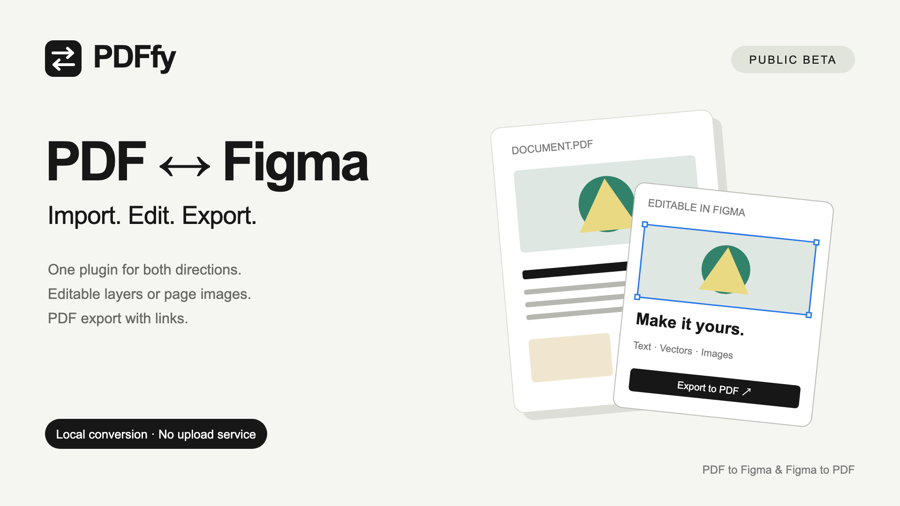

# PDFfy

**PDF to Figma & Figma to PDF — beta 0.1.0-beta.1**



A separate, offline plugin built from the published Figma-to-PDF v9.0.2 source, including its final shared-mask size safeguard. The original exporter project is untouched. Use the top switch to choose a direction; changing modes keeps the current file queue and export settings. Mode switching is locked during a conversion.

Source and issue reporting: [iamdbuko/PDFfy](https://github.com/iamdbuko/PDFfy). See [beta validation](docs/BETA-VALIDATION.md) for tested behavior, known fidelity differences and publication status.

## Install locally

1. In Figma Desktop, open a design file with editing and plugin access.
2. Choose **Plugins → Development → Import plugin from manifest** and select this folder's `manifest.json`.
3. Run **PDFfy — PDF to Figma & Figma to PDF (Beta)** from Development.

The generated `code.js` and `ui.html` are included; installing dependencies is only necessary for development. PDFfy has its own Figma-assigned ID, `1703175034563542365`. It does not update or replace the original exporter's Community listing.

## PDF to Figma

- Choose or drop multiple PDFs. All parsing and conversion stay on your device.
- Preview pages, toggle thumbnails, or enter ranges such as `1–3, 5`. Blank means all pages; `none` deselects every page. Previews are paginated in groups of twelve.
- **Editable layers:** native text, SVG vector geometry, embedded image fills, drawing order, transforms, supported clipping, opacity, and simple axial/radial gradients. Unsupported effects stop the import with a specific explanation.
- **Page images:** render the PDF at 1×–4× density; page frame dimensions stay unchanged.
- Arrange page frames vertically, horizontally, or in a grid inside a named section. Set spacing and grid columns.
- Password prompts support protected PDFs. Passwords are not persisted.
- Detect source fonts, choose installed replacements, and apply mappings again to the last completed import. Missing fonts use reported substitutions. A plugin cannot install embedded PDF fonts into Figma.
- Supported web links become prototype hotspots. Internal page links are mapped when the target page is included in the same import.
- Cancellation or conversion failure removes the current import's partial section. Previously completed imports remain. Completion/cancellation races report whether pages were already committed.
- No account, subscription, watermark, page quota, or import-count paywall.

## Figma to PDF

The existing exporter remains available, including page ordering, individual page sizes, native text and prototype links, vector/raster export, PNG/JPEG choices, image resolution, sRGB/Display P3/document profiles, offline CMYK with bundled or custom ICC profiles, split output, oversized-page handling, progress and cancellation.

See [the preserved exporter documentation](EXPORTER.md), [interface details](docs/INTERFACE.md), and [export limits](docs/FUNCTIONALITY-AUDIT.md). Historical release documents describe the original exporter; they are not PDFfy publishing instructions.

## Fidelity and limits

This beta does **not guarantee full fidelity or feature parity with pdf.to.design PRO**. The [comparison and primary sources](docs/IMPORT-COMPARISON.md) separate documented competitor claims from implemented and verified behavior.

- Figma Design only. FigJam, Slides and Buzz support is not implemented.
- UI file limit: 128 MiB per PDF, 256 MiB queued. Page dimensions: 16,384 px per side. Raster output and embedded editable images: at most 4,096 px per side and 16 million pixels. Large drawings also have bounded operator, layer, payload and canvas extents. These are resource limits, not paid tiers; 10 GB imports are not supported.
- Text is reconstructed from PDF text runs. Font substitution, kerning, nonuniform scaling and different font metrics can change its appearance. Review against the preview. Missing Unicode mappings cannot be recovered automatically.
- Text already converted to drawing outlines stays editable vector geometry. In native Figma PDFs, hidden Type 3 searchable text is omitted so it does not duplicate visible outlines; those letters cannot be edited as text. Type 3 fonts with painted glyph programs are unsupported in Editable layers mode.
- Editable conversion does not yet support every soft mask, blend mode, isolation group, mesh/two-circle gradient, tiled pattern, vertical writing, PDF text rendering modes that stroke or clip with glyphs, or annotation appearance. Use Page images for these documents. It does not silently flatten an unsupported editable page.
- Scanned PDFs stay images. There is no OCR, automatic paragraph reconstruction, auto layout reconstruction, interactive form editing, or bookmark import.
- Embedded ICC profile matching is not supported for import: PDF.js uses alternate color conversion, including in previews. Print PDF colors can differ from a color-managed viewer. Existing CMYK export support does not make import a lossless CMYK/ICC round trip.
- Fonts, images and complex effects should be checked in Figma before relying on a final design. Browser tests and API checks are evidence for covered fixtures, not a universal conversion guarantee.
- Native round-trip checks showed small text-position changes and JPEG artifacts when Figma's native PDF exporter encoded a tiny image. Vector export does not guarantee lossless image pixels. CMYK output is ICCBased four-channel data; it is not certified PDF/X or a physical print proof.

## Develop

Use Node.js 22.13+ or 24+.

```sh
npm ci --ignore-scripts
npm run build
npm test
```

The first browser test run may require `npx playwright install chromium`.

- `src/export-main.js`: retained exporter Figma-side logic plus import routing.
- `src/import-main.js`: Figma layer creation, fonts, layout and transactional import protocol.
- `src/pdf-import.js`: local PDF.js parsing, rendering and editable conversion.
- `src/import-ui.js`, `src/import-shell.html`: import controls and mode switch.
- `src/ui.html`: existing exporter UI and PDF assembly.
- `scripts/build.mjs`: generates `code.js` and self-contained `ui.html`, including offline libraries, resources and license notices.

PDF.js is pinned to 6.5.438 (Apache-2.0). Its parser worker runs locally in the plugin UI; the manifest permits no external network access. PDF.js fonts, character maps and decoder data ship with the bundle. Existing pdf-lib, LittleCMS and image-decoder notices are retained in `licenses/` and the runtime.

See [beta validation](docs/BETA-VALIDATION.md) for the current tested build. The earlier [0.1.0 preview record](docs/PDFFY-VALIDATION.md) is historical.
