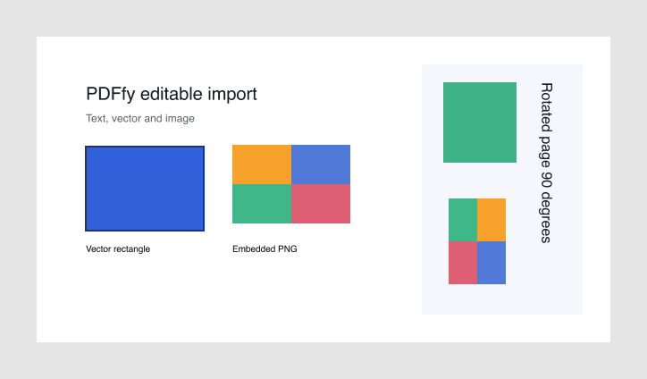

# PDFfy 0.1.0-beta.1 — validation and publication status

Recorded November 13, 2026. The checks below used synthetic fixtures and the actual installed development plugin in **Figma Desktop on macOS**, followed by independent inspection of saved PDFs. A separate creator-run submitted-build check is recorded below. Local validation passed for these cases, exact-commit hosted CI passed, and the GitHub beta prerelease is published. Figma received the submission, but **review remains pending**; public availability and installation by other users are not verified.

This record extends the earlier [development-preview validation](PDFFY-VALIDATION.md): the installed plugin workflow, native undo/cancellation, and an import → export round trip have now been exercised. It does not establish identical conversion for every PDF, font, platform, or PDF viewer.

## Release status

| Destination or check | Verified state |
| --- | --- |
| Source/tag | Commit `362cbdabe861b07f63426fe13232c41321a417b9`, tag `v0.1.0-beta.1` |
| Hosted CI | [Exact release-commit run passed](https://github.com/iamdbuko/PDFfy/actions/runs/43507908772) |
| GitHub | [0.1.0-beta.1 prerelease published](https://github.com/iamdbuko/PDFfy/releases/tag/v0.1.0-beta.1) |
| Figma submission | [Version 1](https://www.figma.com/community/plugin/1703175034563542365), dated November 13, 2026; submitted, awaiting review |
| Submitted-build creator access | Import, internal prototype navigation and saved-PDF check passed |
| Public Community availability/general-user installation | Not verified while Figma review is pending |

See the [publication record](releases/v0.1.0-beta.1-publication.json). This documentation update does not alter the tagged release, source archive or historical build record.

## Automated checks

The complete local suite passed **340 tests, 0 failed, 0 skipped**. It includes the inherited exporter checks and the new parser, import controller, and browser UI checks. See the [complete test log](qa/beta-full-tests.txt).

The browser tests exercise real PDF parsing and rendering with HTTP requests blocked; the Figma message transport is controlled at that test layer. The native desktop checks below provide separate evidence for the installed plugin and actual Figma APIs.

## Installed Figma Desktop checks

| Workflow | Observed result |
| --- | --- |
| Installation and launch | The installed PDFfy development plugin opened successfully with the combined interface. |
| Editable import | `pdffy-live.pdf` imported as two page frames in a two-column grid with 40 px spacing. Actual content included **5 text layers, 4 vector layers, and 2 image rectangles**. |
| Page dimensions and rotation | Frames measured **360 × 240** and **180 × 280**. The source page's 90-degree orientation was retained; its native text rotation was −90 degrees in Figma. |
| Page selection | Range `3` was rejected for the two-page fixture; `1–2` was accepted. |
| Font detection and remapping | The fixture reported one source font style, Helvetica Regular. Applying Arial Black Regular updated all **5 native text layers**. |
| Multiple files and passwords | `import-password.pdf` and `native-links.pdf` imported together. An incorrect password triggered a retry; the correct password succeeded. The two pages retained their outlined-text warnings and **5 URL hotspots per page**. |
| Page images | Importing `native-links.pdf` at 2× produced a **600 × 400** page frame with a **1200 × 800** image and no text layers. |
| Native undo | Undo removed only the latest image import and preserved three earlier import sections. |
| Cancellation and recovery | A 40-page fixture with 160 text runs per page was cancelled during page 2. Figma acknowledged cleanup, the UI unlocked, and an actual API read found no remaining partial-import artifact. Three prior sections remained unchanged. |

## Import → export verification

The editable two-page fixture was exported through the actual plugin as **Vector / As file RGB / 72 dpi** and **Vector / built-in CMYK / 72 dpi**. Independent PDF structure inspection and rendering confirmed:

- Both pages retained their display dimensions, orientation, vector content, and all five text runs. Extracted text matched after normalizing extraction whitespace.
- Each page retained one 24 × 16 embedded image.
- CMYK paint and image resources used four-channel ICCBased data with the exact bundled ISO Coated v2 300% profile. Decoded CMYK image byte counts matched four channels.
- Six rendered pages were reviewed: the source, RGB output, and CMYK output. No missing content, wrong rotation, or overlap was observed.

The linked two-file batch was separately exported as **Rasterized / sRGB / 72 dpi / PNG**. Independent inspection confirmed two 600 × 400 PDF pages, one losslessly compressed 600 × 400 RGB image per page, and an explicit sRGB profile on each page. All **10 external URI links** survived, including repeated URLs; maximum annotation-rectangle error was below **0.00001 pt**. Both batch pages contained identical raster pixels. Rendered comparison found no missing or duplicated visible lettering.

The detailed local inspection reports remain in ignored `test-results/beta-native/`; only aggregate results and synthetic screenshots are published here. Private Figma file and node identifiers are omitted.

## Creator-run submitted-build check

After submission, the creator launched the submitted plugin through Figma Community's **Open in → file → Run** flow. This was separate from the local development-plugin checks above and does not establish access for other users while review is pending.

- Editable import created two correctly sized/rotated pages with **7 text layers, 6 vector layers, 2 images and 2 link hotspots**: one URL and one internal-page target.
- In Figma's prototype viewer, clicking the imported internal hotspot on page one navigated to the rotated second page.
- The saved PDF retained page dimensions **360 × 240** and **180 × 280**, all seven source text runs, vector content and images.
- Independent inspection confirmed the exact external URL and an internal `/Dest` targeting the actual second page with `/Fit`. Maximum link-rectangle error was **0.00000312 pt**.
- Both PDF renders were reviewed with no missing content, wrong rotation, clipping or overlap. The known text-metric, JPEG and extraction-spacing differences below remain applicable.

This verifies the creator-access submitted build's covered behavior. Public listing access and installation by a general user remain unverified.

## Fidelity warnings observed

- Text baselines differed from the source by a few points. Font metrics and substitutions can change typography; this round trip is not lossless text reconstruction.
- Figma's native vector PDF export encoded the tiny PNG fixture as JPEG. The retained image dimensions were correct, but visible compression artifacts appeared in this deliberately low-resolution image. Vector export does not guarantee lossless image pixels.
- CMYK conversion changed saturated blue and some image colors. Rendered inspection is not a physical print proof.
- The CMYK output contained **no catalog OutputIntent**. This is not a PDF/X result or a claim of print-production compliance.
- Nonpainting Type 3 search metadata produced bounding-box warnings in Poppler. Visible outlined glyphs rendered, while extracted text included additional spacing. Native outlined letters remain vectors rather than font-editable text.
- Rasterized PNG export stores lossless Flate-compressed image data inside the PDF; it does not embed a PNG file container.

## Remaining verification boundaries

Native internal-page prototype navigation and the exported PDF's internal destination passed in the creator-run submitted-build check above. Other operating systems and the Figma browser environment have not received the same native end-to-end check. General-user Community installation still requires verification after Figma review completes.

This beta does not implement OCR, automatic paragraph/auto-layout reconstruction, interactive PDF form editing, other Figma editors, or embedded ICC profile matching during import. Some fonts, masks, blend modes, patterns, gradients, clipping modes, and other complex PDF features remain unsupported in Editable layers mode. Page images are an explicit alternative, subject to the documented resource limits. See the [feature comparison](IMPORT-COMPARISON.md) and [README](../README.md).

Exact-commit remote CI and GitHub prerelease publication are verified separately from local tests. Figma submission receipt and creator-access execution do not confirm public Community availability. Keep the review-pending state explicit until public access and general-user installation are verified.
