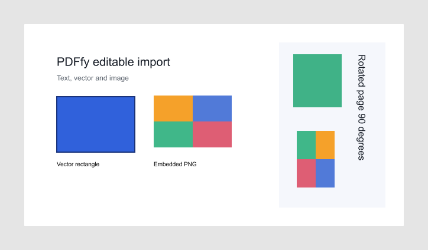

# PDFfy 0.1.0 development preview — validation

Validated on November 13, 2026. This is a local development build, not a Community release or a claim of complete pdf.to.design PRO parity.

## Automated checks

| Check | Result |
| --- | --- |
| Complete inherited exporter and new importer suite | 336 tests passed, 0 failed |
| Import renderer browser tests | 12 passed within the full suite |
| Figma import protocol tests | 16 passed within the full suite |
| Built import UI browser tests | 6 passed within the full suite |
| Final UI and runtime-notice checks after packaging/help changes | 8 passed, 0 failed |
| Generated backend syntax | Passed `node --check code.js` |
| Preview build isolation | Canonical `code.js` and `ui.html` bytes and modification times unchanged |
| Preview output reproducibility | Preview backend and UI byte-identical to canonical build |
| Import browser HTTP requests / uncaught exceptions | Zero in the covered UI scenarios |

The complete suite ran before the final build-destination fix and color-help text addition. The affected build workflow, six UI scenarios and two notice checks were verified again afterward. No importer/exporter conversion logic changed after the complete run. Logs are in [qa/full-tests.txt](qa/full-tests.txt) and [qa/final-targeted-tests.txt](qa/final-targeted-tests.txt). Exact final artifact hashes and sizes are in [qa/build-record.json](qa/build-record.json).

The covered import cases include real PDF previews, true editable Helvetica text, outlines, embedded images, gradients, rotation, selected page ranges, multiple files, density, password retry/cancel, malformed input, unsupported-effect errors, links, cancellation rollback, font replacement/remapping, stale messages and operation locking. SVG renders are compared against the source PDF renderer for controlled fixtures. Native Figma outlined glyphs and their hidden searchable text are tested to prevent duplicate visible lettering.

The inherited export regression suite covers page ordering, links, image resolution, color profiles, CMYK conversion, retained resources, multipart output, progress and cancellation. Its PDF assembly code and helper modules were retained. Export backend integration adds import routing, mutual exclusion and a taller UI; it does not replace the established export pipeline.

## Actual Figma layer creation

The production import controller was exercised through the Figma API bridge in the existing synthetic regression file, on a dedicated **PDFfy — Import tests** page. Input was the real conversion output from [pdffy-live.pdf](../tests/fixtures/pdffy-live.pdf).

- Two page frames were created at **360 × 240** and **180 × 280**; the second page's 90-degree rotation was preserved.
- Actual created nodes include **5 text layers, 4 vector layers and 2 image rectangles**, within SVG/page containers and one section.
- Text contents were read back and verified. Helvetica substituted to Arial with an explicit warning.
- The resulting Figma screenshot was visually inspected: text, rectangle fills/strokes, embedded images and page rotation were present.

[View the synthetic import screenshot](qa/figma-import.png).

This check used the real Figma creation, image and font APIs. A transport adapter captured messages instead of opening the plugin UI, replaced viewport behavior with a stub, and omitted optional `setPluginData` metadata because the API bridge does not support it. It therefore verifies actual layer creation, but **does not verify installing and running the combined local plugin end to end in Figma Desktop**, native undo behavior, or a complete import→export round trip. Browser tests cover the generated UI separately. These desktop checks remain a release gate in [RELEASING.md](RELEASING.md).

## Reference inspection and limits

The reference Community listing and current publisher documentation were inspected. Running the reference in the available browser file was blocked by Figma's Full seat requirement; no seat request or purchase was submitted. The proprietary conversion output was not independently benchmarked. See [IMPORT-COMPARISON.md](IMPORT-COMPARISON.md) for sources and the feature matrix.

Known gaps include other Figma editors, very large files, OCR, paragraph/auto-layout recovery, interactive forms, painted Type 3 fonts, vertical/clipping text, complex masks/blends/patterns/gradients, and embedded ICC color matching. Fonts and text metrics may differ; outlined text remains vectors. Page images provide an explicit alternative for unsupported editable effects. The preview has resource limits and is not guaranteed to preserve every PDF.

The new source lives separately from the original exporter. No GitHub push, hosted CI run, Community publication or paid action was performed.
